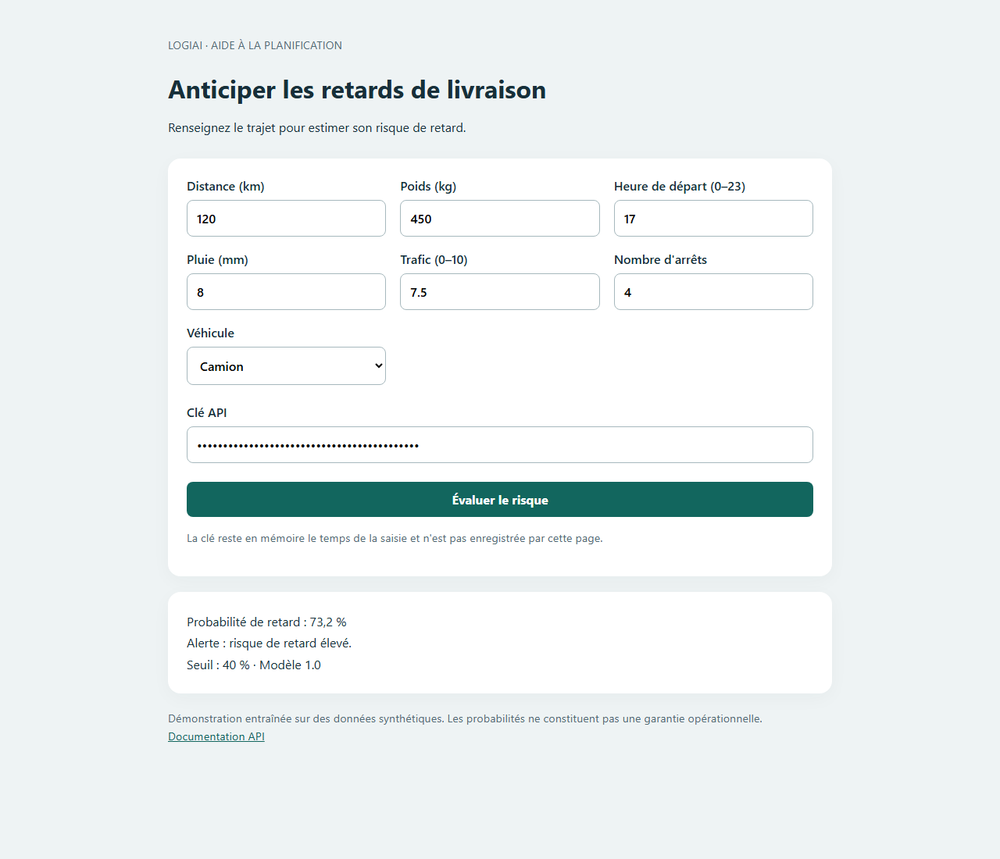
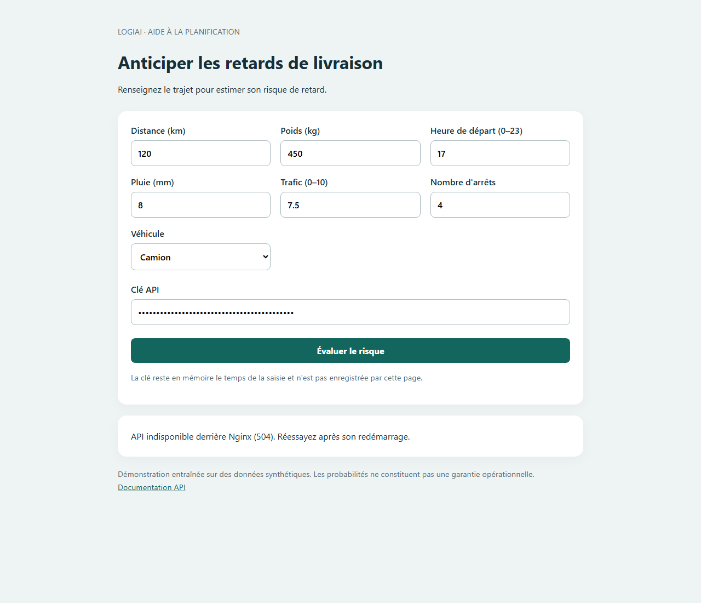

# Atelier 5 — Conteneuriser et déployer LogiAI avec Docker

**Étudiants :** Mehdi Chmiti et Ismail Haddaoui

**Enseignante :** Mme Soukaina Gouraguine

**Module :** Développement et déploiement d’applications intelligentes

**Année universitaire :** 2026–2027

**Date des essais :** 11 novembre 2026

**Branche :** `atelier5` — dépôt `mccrking/LogiAI`

## 1. Objectif et premier constat

Nous avons placé l’API FastAPI et la page web dans deux conteneurs. Nginx sert
la page et relaie `/api/` vers l’API ; Compose décrit les ports, les secrets,
les volumes et l’attente de disponibilité.

| Hypothèse sur la machine | Garant avant Docker | Solution retenue |
|---|---|---|
| Python et bibliothèques compatibles avec le modèle | `.venv` local | Python 3.12 et dépendances principales fixées dans l’image |
| Deux clés API configurées | Fichier `.env` préparé manuellement | Secrets locaux injectés à l’exécution |
| Modèle et métadonnées présents | Commandes dataset et train | Artefacts préparés explicitement, copiés puis montés |
| API et page démarrées | Deux terminaux | Une commande Compose |
| Ports et origines corrects | Configuration manuelle | Ports 8080/8001 et chemin relatif via Nginx |

**Si je donne mon dossier à un camarade, il doit** disposer de Docker Desktop
avec le moteur Linux, créer son propre `.env`, préparer les artefacts, puis
lancer Compose. Aucun environnement Python n’est nécessaire sur Windows :
`scripts/prepare-model.ps1` effectue la préparation dans un conteneur distinct.

## 2. Préparation et contrôles initiaux

- Docker Engine 29.4.3 et Compose v5.1.3 accessibles ; moteur Linux actif.
- Branche `atelier5` créée à partir de `main`.
- Suite pytest : **55 passed**, avant et après adaptation de l’API.
- Modèle, métadonnées et CSV présents avant le build final.
- Préparation Docker exécutée : 5 000 livraisons, 27,4 % de retards ; exactitude
  0,774, rappel 0,464, précision 0,617 et AUC 0,769, sur données synthétiques.
- Python **3.12-slim** remplace l’exemple 3.11 du support pour conserver la version
  du projet. Cette adaptation est expliquée dans l’ADR 004.

## 3. Fichiers de conteneurisation

Les deux Dockerfile, Nginx et Compose sont reproduits en annexe ci-dessous.
Les dépendances sont installées avant la copie du code pour conserver le cache.
L’étape `trainer` prépare volontairement les artefacts ; l’API ne réentraîne pas
son modèle au démarrage. L’étape finale lance Uvicorn sur `0.0.0.0`, avec
l’utilisateur `logiai`, UID 10001, sans droits root.

`LOGIAI_HOME` est effectivement lu dans `logiai/config.py`. Le préfixe
`LOGIAI_ROOT_PATH=/api` permet à Swagger de proposer les bonnes URL derrière
Nginx. Les dépendances de test sont séparées des dépendances d’exécution.

`.env` et ses variantes sont exclus du contexte Docker et de Git. Un contrôle
dans l’image a confirmé l’absence de `/app/.env`. Les secrets ne figurent pas
dans les captures ni dans ce compte rendu.

## 4. Activité 1 et trois expériences

L’image `logiai:1.0` a été construite puis lancée avec :

```powershell
docker build -t logiai:1.0 .
docker run -d --name logiai-api-test -p 127.0.0.1:8001:8000 --env-file .env logiai:1.0
```

Sur le port 8001 : santé **200**, prédiction sans clé **401**, avec la clé **200**.
Le conteneur de test a été arrêté puis supprimé entre les expériences.

| Expérience | Prévu | Obtenu | Explication |
|---|---|---|---|
| Sans `--env-file` | Santé disponible, prédiction refusée | Santé 200 avec modèle chargé ; prédiction 401 malgré la clé locale | Le `.env` de l’hôte n’est pas dans l’image et aucune clé attendue n’arrive au processus |
| Sans `-p` | Conteneur actif, API inaccessible depuis Windows | Santé interne correcte ; erreur de connexion externe ; aucun port publié | `EXPOSE` documente le port sans le publier |
| Uvicorn sur `127.0.0.1` | API accessible seulement depuis son conteneur | Santé interne correcte ; connexion externe interrompue malgré `8001:8000` | L’interface loopback interne n’accepte pas le trafic du réseau Docker |

Le troisième essai utilise une copie temporaire du Dockerfile et le tag
`logiai:test`. Le Dockerfile final conserve `--host 0.0.0.0`.

## 5. Nginx et origine unique

La page envoie `POST /api/v1/predict` au même hôte et au même port que ceux qui
l’ont servie. Nginx joint `api:8000` par le DNS interne et retire `/api/` grâce au
slash final de `proxy_pass`. FastAPI reçoit `POST /v1/predict` et vérifie la clé
`X-API-Key`, conservée par le proxy.

Le test automatisé dans Chromium a observé
`http://localhost:8080/api/v1/predict`, une réponse **200**, l’affichage
**73,2 %** et l’alerte. Aucune requête `OPTIONS` ne précède la prédiction : page
et API ont la même origine. Les méthodes et URL ont été relevées par
l’instrumentation réseau du navigateur, plutôt que par une capture manuelle de
F12. Pour reproduire manuellement : F12 > Network, envoyer le formulaire et
filtrer sur `predict`, puis `OPTIONS`. Ne pas capturer les valeurs des clés.



## 6. Compose et tests de bout en bout

`docker compose config --quiet` valide le fichier. Le démarrage est effectué
avec `docker compose up -d --build --wait --wait-timeout 120`. Le healthcheck
utilise urllib dans le conteneur et exige aussi `model_loaded: true`.
`condition: service_healthy` attend cette disponibilité avant de démarrer Nginx.

| Service | État observé | Ports sur l’hôte |
|---|---|---|
| `logiai-api` | Up et healthy | `127.0.0.1:8001` vers 8000 |
| `logiai-web` | Up | `127.0.0.1:8080` vers 80 |

| Requête par Nginx | Code obtenu |
|---|---|
| `GET /api/health`, sans clé | **200** |
| `POST /api/v1/predict`, sans clé | **401** |
| `POST /api/v1/predict`, fausse clé | **401** |
| `POST /api/v1/predict`, bonne clé | **200** |

Le script `scripts/smoke_docker.py` vérifie aussi une entrée invalide (**422**),
le rôle administrateur avec une clé utilisateur (**403**), Swagger et le schéma
OpenAPI (**200**), sans journaliser les clés. Réponse de démonstration :

```json
{"probabilite_retard":0.732,"alerte":true,"seuil":0.4,"model_version":"1.0"}
```

### Arrêter puis réparer

Après `docker compose stop api`, un premier essai a renvoyé **502**. Avec la
limite de connexion Nginx de 3 secondes, un essai a renvoyé **504** lorsque le
réseau a expiré avant de signaler le refus. La page traite ces deux cas :
« API indisponible derrière Nginx (code reçu). Réessayez après son redémarrage. »
Le code réel remplace « code reçu » dans le message affiché.

Le redémarrage utilise `docker compose start --wait api` pour attendre que le
modèle soit chargé avant de réessayer. Le contrôle de reprise a confirmé
le retour à **200**, l’affichage de la probabilité et l’absence d’exception JavaScript.



## 7. Logs et relevés de ressources

Les logs API montrent le démarrage Uvicorn sur `0.0.0.0:8000`, `/health`, les
prédictions **200**, les refus **401**, la validation **422** et le contrôle
de rôle **403**. Les logs web montrent `/api/...` et les erreurs de connexion
à l’amont pendant la panne.

```powershell
docker compose logs --tail=30 api
docker stats --no-stream --format '{{json .}}' logiai-api
docker compose exec -T api ls -l /app/models
```

| Mesure ponctuelle du 11 novembre 2026 | Valeur observée |
|---|---|
| CPU | 0,32 % |
| Mémoire | 120 MiB sur 7,575 GiB |
| Pourcentage mémoire | 1,55 % |
| Réseau entrant / sortant | 10,4 kB / 10,1 kB |
| PIDs | 24 |
| Entrées/sorties disque | 0 B / 0 B |

Ces valeurs varient avec l’activité. Les PIDs incluent les tâches/threads et ne
signifient pas 24 processus Python séparés. Les consultations ponctuelles des
logs sont utilisées pour l’automatisation ; `docker compose logs -f api` permet
le suivi interactif demandé en séance, que l’on quitte avec Ctrl+C.

## 8. Volumes et décisions

`ls /app/models` affiche `model.joblib` et `model_info.json`. L’inspection Docker
confirme les montages de `/app/models` et `/app/data` en lecture seule : ils
masquent les copies contenues dans l’image.

Un nouveau modèle est visible sans reconstruire l’image, mais il faut redémarrer
l’API pour le recharger en mémoire. Le code `logiai/`, copié et non monté, impose
une reconstruction. L’[ADR 004](docs/adr/004-docker.md) justifie COPY avec volumes
et les ports 8080/8001, publiés uniquement sur la machine locale.

### Présentation sur le réseau local

Pour permettre à l’enseignante d’ouvrir le site depuis une autre machine du
même réseau, la publication du service web est devenue configurable :
`${LOGIAI_WEB_BIND:-127.0.0.1}:8080:80`. Par défaut, l’accès reste limité au PC.
Pour la présentation, `LOGIAI_WEB_BIND=0.0.0.0` a été ajouté au `.env` local,
puis les conteneurs ont été recréés avec `docker compose up -d --wait`.

L’adresse Wi-Fi relevée lors des essais est **10.40.15.50**. L’adresse à saisir
est **http://10.40.15.50:8080**. La page, la santé et une prédiction ont été
vérifiées depuis le PC hôte via cette adresse. L’accès depuis le poste de
l’enseignante reste à confirmer sur place : il dépend du pare-feu et d’une
éventuelle isolation des clients Wi-Fi.

La règle existante « Docker Desktop Backend » autorise Docker sur le profil
réseau actif ; aucune règle de pare-feu n’a été ajoutée. Le port 8001 reste lié
à `127.0.0.1`, tandis que le navigateur distant utilise Nginx et une clé
utilisateur. La machine et Docker doivent rester allumés. Cette adresse privée
ne permet pas un accès depuis Internet et peut changer au prochain réseau.

## 9. Cinq questions de compréhension

1. **Image et conteneur : quelle différence ?** L’image contient les couches du
   programme ; un conteneur est une instance exécutée avec une couche inscriptible.
   La suppression du conteneur ne supprime pas l’image.
2. **Pourquoi `EXPOSE` ne suffit-il pas ?** Il ne publie aucun port sur l’hôte.
   `-p hôte:conteneur` ou `ports` dans Compose effectue cette publication.
3. **Pourquoi `/api/v1/predict` dans la page ?** Ce chemin garde la même origine
   et laisse Nginx résoudre `api`, un nom propre au réseau Docker.
4. **Pourquoi `service_healthy` ?** L’ordre de démarrage ne garantit pas que le
   modèle est prêt. Cette condition attend la réussite du contrôle de santé.
5. **Qu’apportent volumes et secrets à l’exécution ?** Les volumes rendent les
   artefacts externes visibles sans nouvelle image ; `env_file` fournit les clés
   sans les inscrire dans une couche de l’image.

## 10. Rendu et limites

Le code, les configurations, les preuves et la documentation sont préparés sur
`atelier5`. La relecture attendue par Ismail Haddaoui doit utiliser un nouveau
clone et son propre `.env`, avec commentaire et approbation réels.

Pull request : https://github.com/mccrking/LogiAI/pull/1

Le chemin temporaire pytest a été corrigé pour ne pas dépendre de l’existence
préalable de `.pytest_cache`, absente d’un nouveau clone. Les workflows vérifient
les tests Python et les appels de la pile Docker sur un runner Linux propre.

Après relecture, fusionner avec « Create a merge commit », puis créer le tag
`tp5` sur le commit fusionné. Le résumé du sujet mentionne aussi `atelier5` : ce
nom est utilisé pour la branche et `tp5` pour le tag final prévu dans les
commandes de remise. La pull request reste ouverte en attente de cette relecture.

Les [tickets de sortie proposés](docs/TICKETS_SORTIE.md) sont à relire puis à
transcrire individuellement sur papier. La réponse personnelle doit être
confirmée par chaque étudiant.

Cette démonstration ne fournit pas HTTPS, rotation automatique des clés,
limitation de débit, supervision durable ou haute disponibilité. Le modèle
synthétique doit être validé sur des livraisons réelles avant un usage opérationnel.

## Annexe — Configurations finales

### Dockerfile

```dockerfile
FROM python:3.12-slim AS base

WORKDIR /app
ENV PYTHONDONTWRITEBYTECODE=1 \
    PYTHONUNBUFFERED=1 \
    LOGIAI_HOME=/app

COPY requirements-runtime.txt ./
RUN pip install --no-cache-dir -r requirements-runtime.txt \
    && useradd --uid 10001 --create-home logiai

COPY logiai/ ./logiai/

# Étape facultative pour préparer les artefacts sans Python installé sur l'hôte.
FROM base AS trainer
CMD ["sh", "-c", "python -m logiai.dataset && python -m logiai.train"]

FROM base AS runtime
COPY data/ ./data/
COPY models/ ./models/

USER logiai
EXPOSE 8000
CMD ["uvicorn", "logiai.api.main:app", "--host", "0.0.0.0", "--port", "8000"]
```

### web/Dockerfile

```dockerfile
FROM nginx:alpine
COPY web/index.html /usr/share/nginx/html/index.html
COPY nginx/default.conf /etc/nginx/conf.d/default.conf
EXPOSE 80
```

### nginx/default.conf

```nginx
server {
    listen 80;
    server_name localhost;

    root /usr/share/nginx/html;
    index index.html;

    location / {
        try_files $uri $uri/ /index.html;
    }

    location /api/ {
        proxy_pass http://api:8000/;
        proxy_connect_timeout 3s;
        proxy_read_timeout 15s;
        proxy_send_timeout 15s;
        proxy_set_header Host $host;
        proxy_set_header X-Real-IP $remote_addr;
        proxy_set_header X-Forwarded-For $proxy_add_x_forwarded_for;
        proxy_set_header X-Forwarded-Proto $scheme;
    }
}
```

### docker-compose.yml

```yaml
services:
  api:
    image: logiai:1.0
    build:
      context: .
      dockerfile: Dockerfile
    container_name: logiai-api
    ports:
      - "127.0.0.1:8001:8000"
    env_file:
      - .env
    environment:
      LOGIAI_HOME: /app
      LOGIAI_ROOT_PATH: /api
    volumes:
      - ./models:/app/models:ro
      - ./data:/app/data:ro
    healthcheck:
      test:
        - CMD
        - python
        - -c
        - "import json, urllib.request; r = json.load(urllib.request.urlopen('http://127.0.0.1:8000/health', timeout=3)); assert r['status'] == 'ok' and r['model_loaded']"
      interval: 30s
      timeout: 5s
      retries: 3
      start_period: 10s

  web:
    image: logiai-web:1.0
    build:
      context: .
      dockerfile: web/Dockerfile
    container_name: logiai-web
    ports:
      - "${LOGIAI_WEB_BIND:-127.0.0.1}:8080:80"
    depends_on:
      api:
        condition: service_healthy
```

### .dockerignore

```text
.venv/
.venv_test/
venv/
.git/
.gitignore
**/__pycache__/
*.py[cod]
.pytest_cache/
.pytest_tmp/
.ruff_cache/
build/
dist/
*.egg-info/
.env
.env.*
!.env.example
.vscode/
.idea/
docs/
tests/
.github/
COMPTE_RENDU*.md
README.md
```
