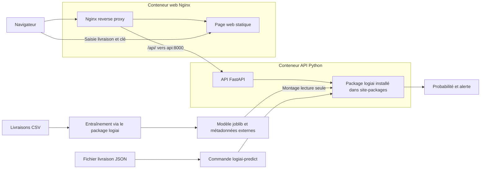

# Étude de conception de LogiAI

## Besoin

## Données

## Modèle et métriques

## Critères d’acceptation

## Cycle de vie

## Architecture

Le même package porte le chargement et l’inférence pour le CLI et l’API.
Le CLI fonctionne sans installer l’extra API. FastAPI apporte sa validation et
son contrôle d’accès ; Nginx sert la page et relaie les requêtes sur une origine
unique. Compose coordonne les deux conteneurs. Le modèle et les données restent
externes au wheel ; `LOGIAI_HOME` désigne leur répertoire. L’entraînement est
une étape explicite du cycle de vie, jamais exécutée par une requête de prédiction.

## Choix technologiques

## Risques et éthique

## Limites
